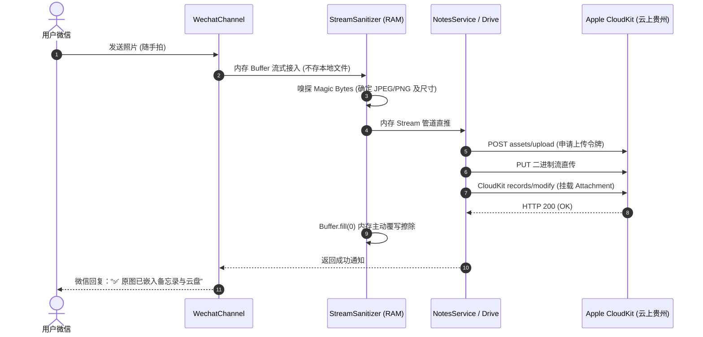

# OmniBridge Core 技术架构与系统设计说明书 (System Architecture Document, SAD)

**文档版本**：v1.0.0  
**定稿时间**：2026-11-06  
**技术选型**：Node.js LTS (ESM) + Modular Bus Architecture + Zero-Knowledge RAM Pipeline

---

## 1. 总体架构拓扑图

系统采用 **“微内核总线式适配器架构（Micro-Kernel Bus & Adapters）”**：

```
       [ Client Apps / Web UI ]
                  │
                  ▼
       [ API Gateway & Router ] (Port 3090)
                  │
  ┌───────────────▼───────────────────────────────────────────────┐
  │                 OmniBridge Core Engine                        │
  │                                                               │
  │  ┌─────────────────────────┐   ┌───────────────────────────┐  │
  │  │ TenantManager           │   │ DualModeRouter            │  │
  │  │ (Multi-Tenant Context)  │   │ (Fast Regex + Local Agent)│  │
  │  └─────────────────────────┘   └───────────────────────────┘  │
  │  ┌─────────────────────────┐   ┌───────────────────────────┐  │
  │  │ StreamSanitizer         │   │ MessageEnvelope           │  │
  │  │ (RAM-only / Zero-Disk)  │   │ (Standard Unified Msg)    │  │
  │  └─────────────────────────┘   └───────────────────────────┘  │
  └───────────────┬───────────────────────────────┬───────────────┘
                  │                               │
        [ Inbound Channels ]             [ Outbound Sinks ]
  ┌───────────────────────────────┐ ┌───────────────────────────────┐
  │ • WeChat Channel (iLink Bot)  │ │ • iCloud Notes (CloudKit CRDT)│
  │ • WechatProbe (errcode -14)   │ │ • iCloud Drive (Web CloudDocs)│
  │ • [TG / Feishu Extensions]    │ │ • IcloudProbe (HTTP 421/401)  │
  └───────────────────────────────┘ └───────────────────────────────┘
```

---

## 2. 核心模块与职责划分

| 模块目录 | 核心类 / 文件 | 核心职责与设计原则 |
| :--- | :--- | :--- |
| `src/core/router/` | `MessageEnvelope.js`<br>`DualModeRouter.js` | **统一消息标准化**：所有端输入输出转换为统一信封对象；负责 <5ms 快速分流规则计算与 AI 工具链编排。 |
| `src/core/tenant/` | `TenantManager.js`<br>`TenantContext.js` | **多租户强隔离**：单例管理器维护独立租户沙箱，杜绝跨租户越权（CWE-639）。 |
| `src/core/security/` | `StreamSanitizer.js` | **零磁盘内存管道**：图片格式嗅探、Magic Bytes 校验、内存擦除释放，严禁磁盘落盘。 |
| `src/channels/wechat/` | `WechatProbe.js`<br>`WechatChannel.js` | **输入侧接入**：腾讯 iLink 微信长轮询调度、心跳探活与 `-14` 错误捕获。 |
| `src/sinks/icloud/` | `NotesService.js`<br>`DriveService.js`<br>`IcloudProbe.js` | **输出侧生态**：自主实现 CloudKit 备忘录原生大图嵌入协议、Drive 云盘分块直传、HTTP 421/401 探活。 |
| `src/app.js` | `server.js` 对应入口 | **微内核装配与服务入口**：REST API 控制器分发、静态托管、异常边界守卫。 |

---

## 3. 数据流转时序（零磁盘无痕流式传输）



---

## 4. 关键接口定义 (REST API Specification)

### 4.1 获取租户健康与系统状态
- **Path**: `GET /api/status`
- **Headers**: `X-Tenant-Id: <string>`
- **Response**:
```json
{
  "ok": true,
  "tenantId": "default",
  "version": "3.0.0-omnibridge-bus",
  "wechat": {
    "status": "ONLINE | EXPIRED | DISCONNECTED",
    "connected": true,
    "accountId": "4547d85e4cb2-im-bot",
    "mode": "DUAL_AUTO",
    "errorMessage": ""
  },
  "icloud": {
    "status": "ONLINE | EXPIRED | DISCONNECTED",
    "connected": true,
    "fullName": "User",
    "errorMessage": ""
  },
  "rules": [...]
}
```

### 4.2 意图分流极速模拟测试
- **Path**: `POST /api/simulate`
- **Request Body**: `{"text": "明天下午两点去菜鸟驿站拿快递"}`
- **Response**:
```json
{
  "ok": true,
  "tenantId": "default",
  "intent": {
    "isQuestionOrChat": false,
    "topCategory": "todo",
    "categoryName": "☑️ 待办与取件码.md",
    "siriPrompt": "“嘿 Siri，我备忘录里有什么待办和取件码？”",
    "probabilities": {"todo": 0.98, "key": 0.01, "link": 0.01, "idea": 0}
  }
}
```
